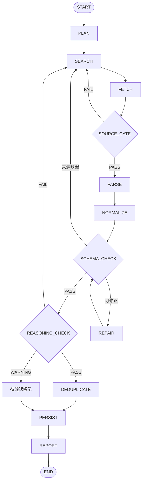

# 食譜蒐集 Graph 工作流

## Graph 節點
1. PLAN：解析主題、數量、語言與來源條件。
2. SEARCH：搜尋候選網址。
3. FETCH：讀取來源頁，記錄成功／失敗。
4. SOURCE_GATE：確認來源可辨識且含實際食譜。
5. PARSE：擷取名稱、材料、份量、時間、溫度與步驟。
6. NORMALIZE：轉為繁體中文欄位，保留原始單位。
7. SCHEMA_CHECK：檢查必要欄位、數字、單位與步驟。
8. REASONING_CHECK：檢查材料與步驟對應、時間邏輯、溫度與設備。
9. REPAIR：只修正格式或可由來源確認的欄位。
10. DEDUPLICATE：比對標題、來源與材料組合。
11. PERSIST：寫入 Wiki、索引與 log。
12. REPORT：彙整狀態與待確認問題。

## 條件邊與迴圈
- SOURCE_GATE 失敗：回 SEARCH。
- SCHEMA_CHECK 可修復：進 REPAIR，再重新驗證。
- 來源缺資料：回 FETCH／SEARCH。
- REASONING_CHECK PASS：進去重與保存。
- WARNING：可保存但明確標記。
- FAIL：不進正式食譜區。
- 最多重試 2 次；超過上限保留錯誤，不無限循環。

## Mermaid Graph

## 本次模擬路徑
PLAN → SEARCH → FETCH → SOURCE_GATE → PARSE → NORMALIZE → SCHEMA_CHECK → REASONING_CHECK → DEDUPLICATE → PERSIST → REPORT。

本次是依照已查閱來源頁面進行人工節點模擬，並非實際啟動 LangGraph runtime。程式骨架另見 `langgraph-example.py`，接上真實搜尋與擷取工具後才能執行完整自動化。