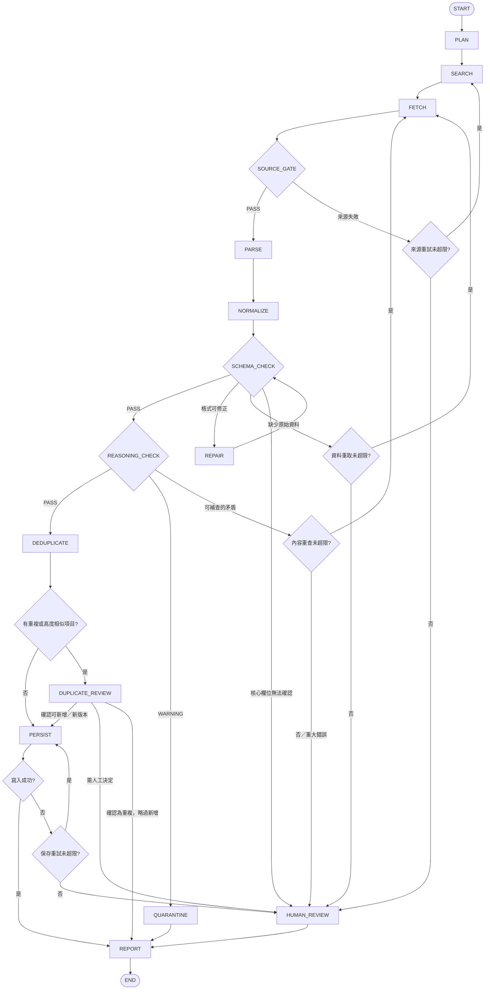

# 食譜蒐集 Graph 工作流（修訂版）

> 本流程定義目標架構；Python 檔目前仍是待接工具的 LangGraph 骨架，不代表已部署自動化服務。

## 一、設計原則
- 每個節點只負責一類工作，輸入、輸出與狀態可追蹤。
- 來源失敗、格式錯誤、內容邏輯錯誤、重複資料及保存失敗分開處理。
- 每個階段預設最多重試 2 次，避免無限循環。
- 只有通過必要驗證的資料才能進入正式食譜區。
- WARNING 只能進待確認區；FAIL 不得發布。
- 既有食譜不直接覆蓋；相似項目先比對，必要時人工決定合併或保留版本。
- GitHub 寫入只有收到成功回應後才能標記完成。

## 二、Graph 節點

| 節點 | 職責 |
|---|---|
| PLAN | 解析主題、數量、語言、來源限制及必要欄位 |
| SEARCH | 搜尋候選食譜網址，不得臆造 URL |
| FETCH | 讀取候選頁面，保留 URL、讀取時間及狀態 |
| SOURCE_GATE | 判斷頁面是否可讀、是否為可辨識食譜來源 |
| PARSE | 擷取原始名稱、材料、份量、時間、溫度與步驟 |
| NORMALIZE | 翻譯及標準化欄位，保留原始數值與單位 |
| SCHEMA_CHECK | 檢查必要欄位、型別、數量單位及完整性 |
| REPAIR | 只修正可由來源證據確認的格式／欄位問題 |
| REASONING_CHECK | 檢查材料與步驟、時間、溫度、設備、安全及過敏原 |
| DEDUPLICATE | 比對標題、來源、材料及步驟相似度 |
| DUPLICATE_REVIEW | 對相似資料決定略過、保留版本或人工合併 |
| PERSIST | 寫入正式食譜、索引與更新紀錄 |
| QUARANTINE | 將 WARNING 放入待確認區，不列為已驗證食譜 |
| HUMAN_REVIEW | 將無法自動判定的 FAIL／重複衝突交由人工處理 |
| REPORT | 彙整數量、狀態、錯誤、重試及實際寫入結果 |

## 三、流程圖

## 四、條件邊與資料規則

### SOURCE_GATE
- PASS：進 PARSE。
- 讀取失敗、頁面非食譜或來源不可辨識：回 SEARCH，改用其他候選。
- 重試超限：進 HUMAN_REVIEW，記錄失敗原因。

### SCHEMA_CHECK
- PASS：進 REASONING_CHECK。
- 格式錯誤且可從原始來源確認：進 REPAIR，修正後必須重新檢查。
- 原始欄位缺漏：回 FETCH／SEARCH。
- 核心材料或步驟無法確認：進 HUMAN_REVIEW，不可自行補值。

### REASONING_CHECK
- PASS：進 DEDUPLICATE。
- WARNING：進 QUARANTINE，保留問題清單，不列為已驗證。
- 可透過重讀來源釐清的矛盾：回 FETCH。
- FAIL 或重大安全疑慮：進 HUMAN_REVIEW，不得發布正式食譜。

### DEDUPLICATE
- 無重複：進 PERSIST。
- 有相似項目：進 DUPLICATE_REVIEW。
- 不可因標題相同就直接刪除；不同作者、份量或配方版本要保留來源與差異。

### PERSIST
- 只有 PASS 且完成去重決策的資料可寫入正式食譜區。
- 寫入成功後才更新 persisted_files。
- 寫入失敗有限次重試；最終失敗須如實回報。
- WARNING 只寫待確認區；FAIL 只保留人工審查紀錄。

## 五、狀態定義
- PASS：來源可追溯、核心欄位足夠，未發現重大矛盾，可進正式食譜區。
- WARNING：仍有明確缺漏、推定或商品標示待確認；只能進待確認區。
- FAIL：來源無效、核心資訊無法確認、重大矛盾或安全疑慮；不可發布。

## 六、重試規則
- 來源讀取、資料重取、內容重查及 GitHub 寫入分別計數。
- 每階段預設最多重試 2 次；達上限後進人工審查或回報失敗。
- REPAIR 不得猜測補齊資料；修正後必須重新通過 SCHEMA_CHECK 與 REASONING_CHECK。
- PERSIST 前必須完成去重，避免重試造成重複寫入。

## 七、本專案目前執行狀態
已建立本流程文件及 LangGraph 範例骨架。真實搜尋 API、網頁擷取器、解析器、去重服務、GitHub 寫入工具、自動化測試及實際 runtime 執行尚未完成。既有食譜整理屬人工模擬／人工整理，不可宣稱為實際自動化 Graph 執行。
