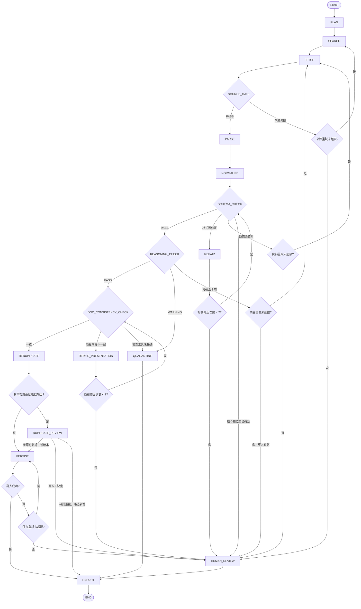

# 食譜蒐集 Graph 工作流（內容稽核修訂版）

> 本流程是預計採用的目標架構；Python 程式目前仍是待接真實工具的 LangGraph 骨架，不代表已部署自動化服務。本次實際核對為人工執行。

## 一、設計原則
- 每個節點只負責一類工作，輸入、輸出、狀態及錯誤可追蹤。
- 來源失敗、格式錯誤、內容邏輯錯誤、文件版本不一致、重複資料及保存失敗分開處理。
- 每個重試階段最多 2 次，避免無限循環。
- 只有來源可追溯且通過必要驗證的資料才能進正式食譜區。
- WARNING 放入待確認區；FAIL 不得發布。
- Markdown Wiki 與 HTML 簡報必須進行內容交叉核對，不能只檢查檔案是否存在。
- 不自動覆蓋既有食譜；相似項目先比較來源、材料及版本差異。
- GitHub 寫入只有收到成功回應後才能標記完成。

## 二、Graph 節點

| 節點 | 職責 |
|---|---|
| PLAN | 解析主題、數量、語言、來源限制及必要欄位 |
| SEARCH | 搜尋候選食譜網址，不得臆造 URL |
| FETCH | 讀取候選頁面，保存 URL、讀取時間、狀態及內容 |
| SOURCE_GATE | 判斷頁面是否可讀、是否為可辨識食譜來源 |
| PARSE | 擷取原始名稱、材料、份量、時間、溫度與步驟 |
| NORMALIZE | 翻譯及標準化欄位，保留原始數值與單位 |
| SCHEMA_CHECK | 檢查必要欄位、型別、單位及完整性 |
| REPAIR | 只修正可由來源證據確認的格式／欄位問題 |
| REASONING_CHECK | 檢查材料與步驟、時間、溫度、設備、安全及過敏原 |
| DOC_CONSISTENCY_CHECK | 將 Wiki Markdown 與 HTML 簡報逐項比對來源、材料、數量、烤溫、時間、步驟及狀態 |
| REPAIR_PRESENTATION | 若簡報與已驗證食譜不符，依 Wiki 的核准資料修正簡報；不得另行生成未核實資訊 |
| DEDUPLICATE | 比對標題、來源、材料及步驟相似度 |
| DUPLICATE_REVIEW | 對相似資料決定略過、保留版本或人工合併 |
| PERSIST | 寫入正式食譜、索引與更新紀錄 |
| QUARANTINE | 將 WARNING 放入待確認區，不列為已驗證食譜 |
| HUMAN_REVIEW | 將無法自動判定的 FAIL／重複衝突交由人工處理 |
| REPORT | 彙整數量、狀態、錯誤、重試及實際寫入結果 |

## 三、流程圖



## 四、條件邊與資料規則

### SOURCE_GATE
- PASS：進 PARSE。
- 讀取失敗、頁面非食譜或來源不可辨識：回 SEARCH，改用其他候選。
- 重試超限：進 HUMAN_REVIEW，保留錯誤及候選來源。

### SCHEMA_CHECK
- PASS：進 REASONING_CHECK。
- 格式錯誤且可從原始來源確認：進 REPAIR，修正後必須重新檢查。
- 原始欄位缺漏：回 FETCH／SEARCH。
- 核心材料或步驟無法確認：進 HUMAN_REVIEW，不可自行補值。

### REASONING_CHECK
- PASS：進 DOC_CONSISTENCY_CHECK。
- WARNING：進 QUARANTINE，保留問題清單，不列為已驗證。
- 可透過重讀來源釐清的矛盾：回 FETCH。
- FAIL 或重大安全疑慮：進 HUMAN_REVIEW，不得發布正式食譜。

### DOC_CONSISTENCY_CHECK
- 必須比較對應 Markdown 與 HTML，至少檢查來源網址、食材名稱與數量、產量、模具、烤溫、主要步驟、冷卻時間及品質狀態。
- PASS：兩份文件一致，進 DEDUPLICATE。
- MISMATCH：回 REPAIR_PRESENTATION；以已驗證的 Wiki 資料為準修正 HTML，修正後重新檢查。
- WARNING：比較器尚未接通或證據不足時，不得回報 PASS；先進 QUARANTINE／人工補查。
- 同一文件最多修正及重查 2 次；仍不一致就進 HUMAN_REVIEW。

### DEDUPLICATE
- 無重複：進 PERSIST。
- 有相似項目：進 DUPLICATE_REVIEW。
- 不可因標題相同就直接刪除；不同作者、份量或配方版本要保留來源與差異。

### PERSIST
- 只有 PASS 且完成去重決策的資料可寫入正式食譜區。
- 寫入成功後才更新 persisted_files。
- 寫入失敗有限次重試；最終失敗須如實回報。
- WARNING 只寫待確認區；FAIL 只保留人工審查紀錄。

## 五、狀態定義
- PASS：來源可追溯、核心欄位足夠、內容可操作，且 Wiki／簡報一致，無重大矛盾。
- WARNING：仍有明確時間、商品標示、來源資訊或自動檢查工具缺漏；不得把未確認數據當成保證值。
- FAIL：來源無效、核心資訊無法確認、文件重大錯置或重大安全疑慮；不可發布正式食譜。

## 六、重試規則
- 來源讀取、資料重取、內容重查、簡報修正及 GitHub 寫入分別計數。
- 每階段最多重試 2 次；達上限後進人工審查或如實回報。
- REPAIR 不得猜測補齊資料；修正後必須重新通過 SCHEMA_CHECK 與 REASONING_CHECK。
- PERSIST 前必須完成文件一致性與去重檢查，避免錯誤及重複寫入。

## 七、本專案目前執行狀態
已完成五份原始來源、五份 Wiki 食譜及五份 HTML 簡報的人工交叉核對，修正發現的錯置與缺漏。DOC_CONSISTENCY_CHECK 已納入目標設計，但 Python 範例尚未接上真實檔案讀取與自動比較工具。真實搜尋 API、網頁擷取器、解析器、去重服務、GitHub 自動寫入、自動化測試及實際 LangGraph runtime 執行尚未完成。既有修訂紀錄屬人工稽核與人工寫入，不可宣稱為自動化 Graph 執行。
```
